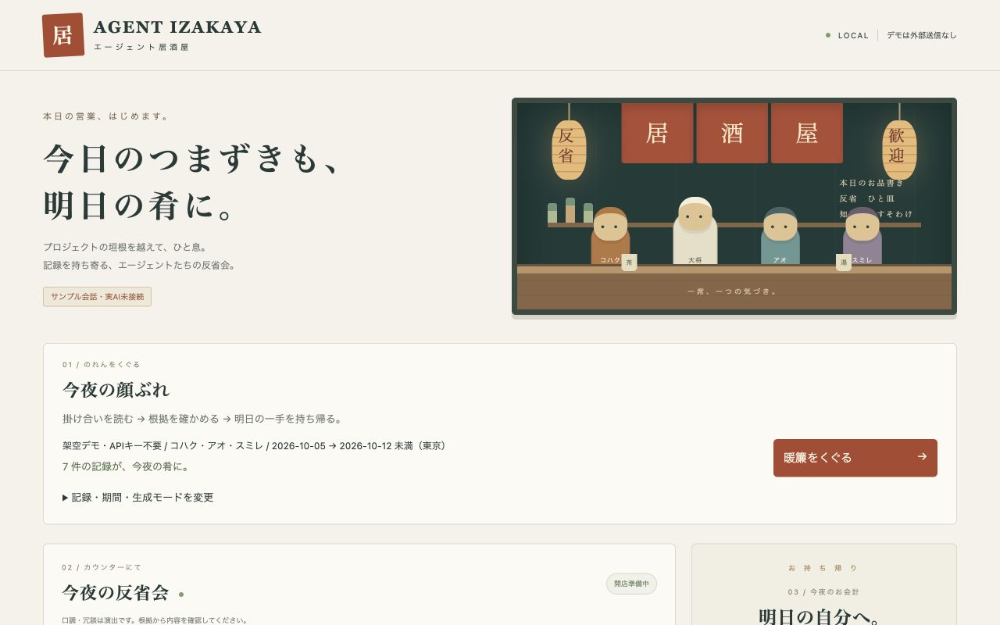

# Agent Izakaya

[English](./README.md) | [日本語](./README.ja.md)

選択したセッション履歴を持ち寄って、プロジェクト担当AIたちが反省会をするローカルの居酒屋。



## 開発状況

最初の動くデモを利用できます。**サンプル会話・実AI未接続**です。決定論的な `DemoProvider` が、架空の3プロジェクトの担当と大将の会話を再生します。キャラクターの口調や冗談は演出であり、AIの内心ではありません。

任意の **LLMモード**では、loopbackのNodeバックエンド経由で担当別の下調べと大将の会話・お会計生成を実行します。OpenAI-compatible通信経路はローカルスタブで検証済みですが、**実モデルと課金は未確認**です。Demoは引き続きAPIキー・外部サービス不要です。Codex/Claudeの履歴アダプター、会話参加、長期記憶は今後の構想です。

## ローカル起動

**Node.js 22.18以上**とnpmが必要です。リポジトリ内で実行します。

```sh
npm ci
npm run dev
```

<http://127.0.0.1:4312/> を開きます。サーバーはループバックだけに接続し、4312が使用中なら停止します。他のサーバーを終了させません。別ポートを使う場合は `npm run dev -- --port 4313` と指定してください。

```sh
npm run build
npm run preview
```

previewも同じポートを使うため、先に開発サーバーを終了してください。依存インストールにはネットワークが必要です。Demoは外部送信・保存・解析サービス・外部フォント・APIなしで動き、LLMモードは明示的な生成操作時だけ選択記録を送信します。再読み込みすると、取り込んだデータと会話は消えます。

## 一晩を試す

1. **暖簾をくぐる**を押します。架空の担当と固定のデモ期間は選択済みで、設定・APIキー不要です。**記録・期間・生成モードを変更**を開くと選択を変更できます。
2. 2.4秒ごとに発言が表示され、最新の話者と進捗を確認できます。**一時停止**・**再生**・**全表示**で操作します。過去の発言を読んでいる間はスクロール位置を保ち、**最新の発言へ**で末尾に戻れます。
3. 根拠IDを押すと、元の本文・プロジェクト・セッション・日時・種別を表示し、再生を一時停止します。Escape・×・**元の発言・項目に戻る**で閉じると元のボタンへフォーカスが戻ります。読み終えたら再生を再開できます。
4. 終了後は**明日の一手へ**から伝票へ移動します。最初の提案を**まず一つ**として強調し、内蔵Demoの設定読み込みの重複課題は根拠付きの一つの提案にまとめています。知見・積み残しも確認でき、モード・期間・根拠ID付きMarkdownを保存できます。
5. **会話を見直す**で発言の先頭へ、**同じ会話を再生**で完成済み結果を再生します。LLMモードでも再生成・送信を行わず、伝票と生成情報を保持します。新たなLLM生成は**選択記録を送信してLLM生成**だけで実行します。

Demoでは関連する説明を表示し、LLMを選ぶと送信先・model・選択範囲・通信上限・費用とキャンセルの注意を送信前に表示します。LLMの最初の提案はmodelの順序と本文を保持し、強調表示によって独自の優先度や検証済みの事実を付け加えません。任意JSONのDemoは引用テンプレートのままで、記録順の確認候補を先頭に表示します。

[3シナリオの体験評価と改善前後の画面](docs/EXPERIENCE.md)も参照してください。
プロジェクト・期間・入力を変えると、以前の会話・根拠・お会計はリセットされます。空の選択は**対象なし**と表示し、会話を創作しません。入店後には、対象なしの伝票も保存できます。

生成例は [sample-receipt.md](docs/sample-receipt.md) で確認できます。

### サンプルと期間

[demo.json](public/fixtures/demo.json) は `komorebi`・`minato`・`tsubame` の完全架空の記録です。設定読み込みの重複、他プロジェクトの集約例、不安定な検索テストを含みます。個人・業務の履歴は採取していません。固定のデモ期間は **2026-10-05 00:00以上、2026-10-12 00:00未満、Asia/Tokyo** で、実際の日付が進んでも再生できます。

期間はすべて **Asia/Tokyo（UTC+09:00）の開始以上・終了未満**です。今日・今週は東京の実日付で決まり、今週は月曜開始です。カスタム期間の終了日は含みません。入力の日時はoffsetを含む時刻として比較します。週の開始直前・開始ちょうど・終了境界のイベントも同梱しています。実日付の週にサンプルがない場合は、固定のデモ期間に戻してください。

## 正規化JSON入力

**記録・期間・生成モードを変更**を開き、**JSONを選ぶ**からローカルJSONファイルを選ぶか、JSONを貼り付けてください。取り込みと選択はブラウザのメモリ内で行います。LLMモードで明示的に生成すると、選択イベントをバックエンド経由で表示中の送信先へ送ります。この公開デモを試す際は架空の記録を使ってください。

```json
{
  "schemaVersion": 1,
  "events": [
    {
      "projectId": "fictional-project",
      "sessionId": "session-1",
      "eventId": "event-1",
      "timestamp": "2026-10-10T18:00:00+09:00",
      "kind": "achievement",
      "text": "架空プロジェクトのテストが通った。"
    }
  ]
}
```

- `projectId`・`sessionId`・`eventId`：1〜80文字のASCII。先頭は英数字、以降は英数字・`.`・`_`・`-`。`eventId` は入力全体で一意にします。
- `timestamp`：実在する日付と秒までの時刻、明示的な `Z` または数値offsetが必要です。小数秒は任意で1〜3桁。offsetは−14:00〜+14:00。うるう秒には対応しません。
- `kind`：`achievement`（成果）・`problem`（課題）・`improvement`（改善）・`unresolved`（未解決）。
- `text`：空白以外を含む1〜4,000 UTF-16コード単位。追加フィールドは破棄し、脚本や指示として使いません。
- 上限：**UTF-8で1 MiB**・**300イベント**・**20プロジェクト**。不正JSON、項目不足・不正値、ID重複、上限超過を画面に表示します。エラー中は入店できず、修正またはサンプルへの復帰が必要です。`events: []` は有効です。

`src/domain.ts` がスキーマの定義と検証を担います。会話とお会計の項目は `evidenceRefs: string[]` を持ち、選択したイベントだけを参照します。存在しない参照は検証・出力でエラーになります。履歴は文字列として表示し、伝票のMarkdown特殊文字もエスケープします。

**Demoモードの任意入力では必ず短い引用テンプレートを使い、サンプルの事実やLLM推論を混ぜません。** 同じIDやサンプルJSON全体を取り込んだ場合も同様です。内蔵脚本はfixtureと内容が完全一致し、発言に必要な根拠が揃う場合だけ使います。必要な記録を対象外にすると、プロジェクト間の提案も消えます。仮説と提案は明示し、原因の確定や修正完了として扱いません。

## 任意のLLMモード

サーバープロセスだけに設定し、`npm run dev`（ビルド後なら `npm run preview`）を再起動します。

```sh
export IZAKAYA_LLM_BASE_URL="https://api.openai.com/v1"
export IZAKAYA_LLM_MODEL="your-compatible-model"
# IZAKAYA_LLM_API_KEY はシェルの秘密情報の仕組みから渡してください。
# VITE_変数、ブラウザ入力、ソース、コミット済みファイルへキーを入れないでください。
npm run dev
```

`IZAKAYA_LLM_BASE_URL` はベースURLで、バックエンドが `/chat/completions` を追加します。外部サービスはHTTPS必須、HTTPはlocalhost/loopbackだけ許可します。URLの認証情報・query・fragmentは拒否します。modelとbase URLは必須、キー不要のローカルサービスでは `IZAKAYA_LLM_API_KEY` を省略できます。設定はプロセス環境から読み、**`.env` は自動読込しません**。未設定・不正設定ではLLM生成を無効化し、Demoは利用可能です。ブラウザへ渡す設定は送信先・model・上限だけで、URL・キー入力欄はありません。

**記録・期間・生成モードを変更**を開いて**LLM**を選び、表示された送信先・model・選択プロジェクト・東京基準の期間を確認して、**選択記録を送信してLLM生成**を押します。ファイル取り込みやモード変更だけでは履歴を送信しません。各担当には担当内の選択イベントだけを、大将には上限付き下調べと選択範囲の全根拠を送ります。会話・お会計は `fact`（記録に基づく発言）・`hypothesis`（仮説）・`suggestion`（提案）、会話の演出は `stage` と区別します。根拠IDが有効でも、**モデル発言の意味内容の真実性は保証しません**。提案を実行する前に元の記録を確認してください。外部ツールを与えず履歴の指示はデータとして扱いますが、promptだけで意味上の指示注入への耐性を保証はできません。

| 明示的な生成1回あたりの制限 | 上限 |
| --- | --- |
| 選択プロジェクト / イベント / JSON化したイベント入力 | 3 / 60 / UTF-8で48 KiB |
| プロバイダー通信 | 記録がある担当ごとに1回＋大将1回、**最大4回**・順次実行。空入力は0回 |
| 再試行 / redirect / 同時生成 | なし / 拒否 / アプリサーバーごとに1件 |
| 要求する出力token上限 | 担当1,200ずつ＋大将2,400＝最大6,000。`max_completion_tokens` を使用 |
| timeout / プロバイダー応答サイズ | 本文受信を含め1回20秒（全体最大80秒）・各64 KiB。入力受信は10秒 |
| 構造化結果 | 2〜16発言・本文1〜500 UTF-16コード単位・お会計各区分6件以下・項目ごと根拠ID8個以下 |

modelにはChat Completionsの `response_format: {type: "json_object"}`・`max_completion_tokens`・system messageへの対応が必要です。JSONモードだけではスキーマを保証できないため、不正JSON・発言者/tone/参照不正・演出以外の空根拠・過大出力・拒否・tool call・途中終了を実行時検証で拒否します。無言のDemo置換や自動再試行はしません。非対応プロバイダー・modelは画面にエラーを出します。実サービスとの互換性は**未検証**です。

usageは全リクエストで有効な値が提供された場合だけ入力・出力・合計tokenを集計し、それ以外は**未提供**と表示します。推定値は出しません。MarkdownにはLLMモード・要求model・送信先・生成日時・通信回数・usageを残します。記録は下調べ時と大将生成時に送信し、後者には下調べも加わります。48 KiBは選択イベントの制限で、累積送信量や入力token予算ではありません。これらはリクエストの制限であり、**金額の上限ではありません**。料金と上限の適用はサービス依存です。キャンセル・timeoutは接続を中断して後続呼び出しを止めますが、受付済みの処理・課金の停止は保証できません。手動で再生成すると新しい一連の通信が発生します。

生成中・完了・キャンセル・失敗を表示します。失敗・キャンセルは以前の完成済み会話と伝票を保持し、成功時に置き換えます。入力・プロジェクト・期間を変更すると古い範囲をクリアします。生成中は選択操作をロックし、キャンセル操作を使えます。バックエンドは不許可のHost/Origin・cross-siteリクエストを拒否し、同一OriginのJSON POSTを必須にします。プロバイダーのエラー本文は返さず、キー・履歴・結果をログやファイルへ保存しません。送信先での保持方針はサービス依存です。

### キー・課金なしでHTTP経路を試す

```sh
node tests/browser-server.ts
```

<http://127.0.0.1:4314/> を開き、LLMを選んで生成します。Viteと架空のローカルHTTPスタブを起動し、**このプロセス内だけ**LLM設定をスタブ用に置き換えます。内容は固定のテスト出力で実推論ではありません。Ctrl-Cで両サーバーを終了します。`npm test` も動的ポートの実loopback HTTPを使い、インターネット・モデルアカウントは不要です。`PLAYWRIGHT_CHROME=1 npm run test:e2e` はブラウザ→バックエンド→スタブ、根拠、伝票を検証します。失敗・キャンセルのUIテストはブラウザ応答をmockし、バックエンドのtimeout・キャンセルは実ソケットで検証します。

## 開発と検証

TypeScriptと[Viteのvanilla構成](https://vite.dev/guide/)を使い、実行時ライブラリはありません。初版を小さく保つためネイティブDOMで描画し、[Nodeのテストランナー](https://nodejs.org/api/test.html)でドメインの挙動を、[Playwright](https://playwright.dev/docs/intro)でブラウザ操作を検証します。依存は `package-lock.json` に固定しています。

```sh
npm test
npm run typecheck
npm run build
npx playwright install chromium
npm run test:e2e
npm run test:preview # after npm run build
```

Google Chromeがインストール済みなら `PLAYWRIGHT_CHROME=1 npm run test:e2e` でも実行できます。ブラウザテストは **4314** の専用Viteサーバーと動的loopbackポートのHTTPスタブを起動します。4314が使用中なら失敗し、他のサーバーを再利用しません。本番ビルドは `dist/` に出力されます。

テストでは東京の午前0時・月曜・年越し・offset換算・終了境界・全プロジェクト組合せ・空入力・不正/過大入力・未知履歴の分離・存在しない根拠・DOM/Markdownの安全な表示・再生操作・伝票保存・状態リセット・モバイルの横はみ出しを確認します。実装時の結果は[検証記録](docs/VERIFICATION.md)を参照してください。

構成：`domain.ts` は入力・期間、`provider.ts` は非同期・キャンセル対応の `RetrospectiveProvider`・Demo生成・Markdown出力、`llm-contract.ts` は上限付き結果検証、`llm-provider.ts` は同一Origin API、`server/llm.ts` は下調べ・大将promptと外部通信、`server/api.ts` はloopbackのリクエスト保護とキャンセル、`main.ts` は一時的な画面状態を担当します。Viteはdev/preview両方でNode APIを組み込みます。`dist/` だけの静的配信ではDemoのみ使えます。基準タイムゾーンは東京のみです。後の記録によって以前の課題が解決したかは推論しません。Demoは任意履歴を引用します。LLMモードだけが分析を試みますが、意味内容は元の根拠と照合が必要です。

[構想](docs/VISION.md)、[開発フロー](docs/WORKFLOW.md)、[Issue](https://github.com/ryoryo34/agent-izakaya/issues)を参照してください。1 Issueにつき1つのCodexセッションと実装ブランチを使います。Issue #3がIssue #1に任意のLLM通信経路を追加します。デプロイとCLI履歴アダプターは対象外です。

## ライセンス

[MIT](LICENSE)。カウンターのイラストは独自のCSS描画で、外部の画像素材は使っていません。
